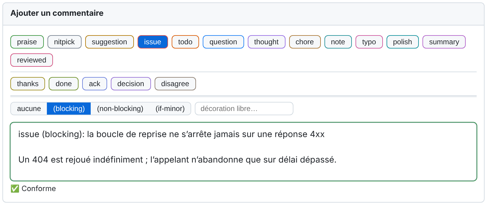
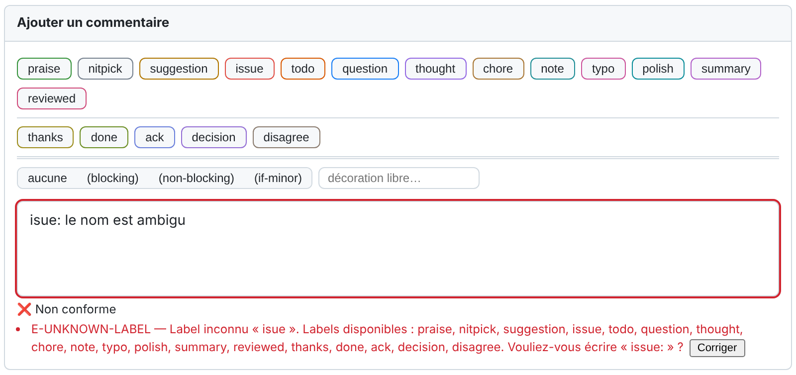
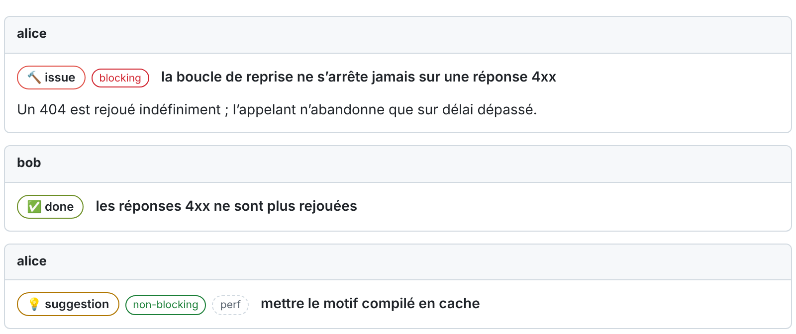

# Conventional Comments Toolkit

**Langues :** [English](README.md) | Français (ce fichier)

[](https://github.com/Reefact/conventional-comments-toolkit/actions/workflows/ci.yml)
[](https://github.com/Reefact/conventional-comments-toolkit/releases)
[](LICENSE)

**Une extension de navigateur qui aide une équipe à écrire des
[Conventional Comments](https://conventionalcomments.org/) en revue de code, sur GitHub,
Azure DevOps et GitLab.**

## Le problème

Un commentaire de revue dit rarement ce qu'il est.

```text
Cette boucle ne s'arrête jamais sur une réponse 4xx.
```

Est-ce un défaut à corriger avant de fusionner, une remarque en passant, une question ?
L'auteur doit deviner, et devine du même coup l'humeur du relecteur. Conventional Comments
tranche avec un préfixe :

```text
issue (blocking): la boucle de reprise ne s'arrête jamais sur une réponse 4xx
```

Tout le monde trouve l'idée bonne. Puis tout le monde oublie de taper le préfixe, le tape
mal, ou l'emploie à sa façon.

## La solution

L'extension ajoute au champ de commentaire de la plateforme ce qui manque à la convention :
les labels à un clic, un retour pendant la frappe, et un résultat lisible une fois publié.



Une erreur est nommée, avec sa correction à un clic :



Les commentaires publiés montrent leur label en badge, et leur sujet en titre :



*Les composants de l'extension, rendus par le code livré sur une page de test aux couleurs du
thème clair de GitHub. Ce ne sont pas des captures de github.com.*

## Ce que vous obtenez

- **Une barre d'outils** dans chaque champ de commentaire de revue : un bouton par label, un
  sélecteur pour `(blocking)`, `(non-blocking)` et `(if-minor)`.
- **La saisie au clavier** : une liste de complétion (`/` ou `:`), des abréviations (`?ib` +
  `Tab` donne `issue (blocking): `) et des raccourcis directs (`Alt+I`).
- **La validation pendant la frappe** : une pastille d'état, un message par problème, des
  corrections en un clic.
- **Des badges** sur les commentaires publiés, un **bandeau** qui compte les fils bloquants
  non résolus de la pull request, et un **filtre** des fils par label.
- **Des labels pour répondre**, ce que Conventional Comments ne couvre pas : `done`, `ack`,
  `disagree`, `thanks`, plus `summary` et `reviewed` pour dire où en est une revue. Ce sont
  des ajouts de cette boîte à outils, activés par défaut, qu'un dépôt peut désactiver.
- **Des règles par dépôt**, dans un seul fichier JSON, et au besoin par organisation.
- **Un blocage facultatif de l'envoi** (mode `enforce`) : un commentaire non conforme est
  arrêté avant sa publication.
- Une interface **en français et en anglais**.

## Installer

1. Téléchargez l'archive de votre navigateur depuis la
   [page des releases](https://github.com/reefact/conventional-comments-toolkit/releases),
   décompressez-la, puis chargez le dossier (`chrome://extensions` → Mode développeur →
   Charger l'extension non empaquetée).
2. Dans la page de réglages qui s'ouvre, autorisez votre plateforme : l'extension reste
   inactive partout tant qu'aucun domaine n'est autorisé.
3. Ouvrez une pull request et cliquez dans un nouveau commentaire.

**→ [Prise en main](docs/guide/getting-started-fr.md)** détaille ces trois étapes en dix
minutes.

## Plateformes

| | GitHub | Azure DevOps | GitLab |
|---|:---:|:---:|:---:|
| Barre d'outils, saisie au clavier, validation | Oui | Oui | Oui (éditeur Markdown) |
| Badges, bandeau, filtre des fils | Oui | Oui | Oui |
| Configuration du dépôt, blocage de l'envoi | Oui | Oui | Pas encore |

GitHub.com, Enterprise Cloud et Enterprise Server ; Azure DevOps Services sur `dev.azure.com` ;
gitlab.com. Chrome, Edge et les autres navigateurs Chromium, Firefox 128 ou supérieur.
[Ce qui fonctionne où, en détail](docs/guide/platforms-fr.md).

## Configurer un dépôt

L'extension n'a besoin d'aucune configuration. Un dépôt qui veut ses propres règles ajoute un
fichier `.conventional-comments.json` à la racine de sa branche par défaut :

```json
{
  "version": 1,
  "mode": "assist",
  "labels": [
    { "id": "issue", "aliases": ["bug"] },
    { "id": "typo", "enabled": false }
  ],
  "toolCommands": ["/*", "@dependabot"]
}
```

[Chaque clé, avec des exemples](docs/guide/configuration-fr.md).

## Ce qu'elle est, et ce qu'elle n'est pas

**Par défaut, elle assiste et ne bloque jamais.** En mode `assist`, un commentaire non
conforme est signalé et part quand même. Une équipe qui veut davantage passe un dépôt en
`enforce`, où le bouton d'envoi refuse un commentaire en erreur.

**C'est un garde-fou, pas un mur.** L'extension agit dans le navigateur où elle est
installée. Un commentaire publié par l'API de la plateforme, un autre navigateur ou un poste
sans l'extension n'est pas contrôlé.

**Elle ne contrôle pas la fusion.** Elle signale les fils bloquants non résolus, mais
n'empêche jamais de fusionner
([DEC0010](docs/idr/DEC0010-the-extension-is-the-whole-product-fr.md)). Une équipe qui veut
conditionner la fusion à la résolution des conversations s'appuie sur les réglages de sa
plateforme.

**Elle contrôle la forme, jamais le fond.** Qu'une remarque soit juste, utile ou aimable
n'est pas son affaire.

## Confidentialité

Aucun contenu de commentaire, de code ou de diff ne quitte votre navigateur. Aucun jeton
n'est stocké. Aucun accès à un site n'est demandé à l'installation : vous autorisez les
domaines un par un. La télémétrie est désactivée par défaut, et un dépôt ne peut pas l'activer.
[Politique de confidentialité](PRIVACY.md).

## Documentation

**→ [Commencez par le guide de dix minutes](docs/guide/getting-started-fr.md)**

| | |
|---|---|
| [Index de la documentation](docs/README-fr.md) | Tout, organisé, en français et en anglais |
| [Rédiger des commentaires de revue](docs/guide/writing-comments-fr.md) | Le format, la barre d'outils, la pastille, les badges et le bandeau |
| [Saisie au clavier](docs/guide/keyboard-input-fr.md) | Complétion, abréviations, raccourcis directs |
| [Labels et décorations](docs/guide/labels-fr.md) | Chaque label, quand l'employer, ce qui rend un commentaire bloquant |
| [Diagnostics](docs/guide/diagnostics-fr.md) | Chaque code de la pastille, et comment le corriger |
| [Configuration](docs/guide/configuration-fr.md) | Le fichier du dépôt, clé par clé |
| [Modes et adoption](docs/guide/modes-and-adoption-fr.md) | `off`, `assist`, `enforce`, et comment y arriver |
| [Déployer pour une organisation](docs/guide/organization-fr.md) | Configuration partagée, règles minimales (le plancher), hôtes, télémétrie |
| [FAQ et dépannage](docs/guide/faq-fr.md) | Quand quelque chose ne s'affiche pas |

## Les labels que la boîte à outils ajoute

Conventional Comments donne un vocabulaire à la **remarque** de revue et ne dit rien de la
**réponse** à une remarque. La boîte à outils livre ses propres labels pour cela. Ils **ne
font pas partie de Conventional Comments** ; un dépôt qui veut s'en tenir à la liste d'origine
les désactive.

| Label | Signification | Aussi accepté |
|---|---|---|
| `thanks` | Remercie, sans prendre position sur le point ni sur le code. | `thx` |
| `done` | Le code a changé à la suite de la remarque. | `fixed` |
| `ack` | Reçu et accepté ; le code n'a pas changé. | `acknowledged` |
| `disagree` | Refuse la remarque, et le sujet dit pourquoi. Ne résout rien. | |
| `summary` | Fait le point sur la revue ou sur une passe : ce qui a été vérifié, ce qui reste ouvert. | |
| `reviewed` | Clôt votre revue : vos points sont traités. N'approuve rien. | |
| `decision` | Acte, avec son motif, qu'un point ne sera pas traité. | |

[Quand employer chacun, et comment les désactiver](docs/guide/labels-fr.md#les-labels-qui-ne-font-pas-partie-de-conventional-comments).

## Pour les agents IA

Deux skills permettent à un agent IA de relire une pull request, ou de répondre à sa revue,
avec ce vocabulaire : [`skills/review-pull-request`](skills/review-pull-request/SKILL.md) et
[`skills/respond-to-review`](skills/respond-to-review/SKILL.md). Aucun des deux n'approuve ni
ne fusionne. [Skills de revue pour les agents IA](docs/guide/review-skills-fr.md).

## Contribuer

Les issues et les pull requests sont les bienvenues. Commencez par
[`CONTRIBUTING.md`](CONTRIBUTING.md) (en anglais).

```
npm install
npm test
npm run build
```

L'organisation du dépôt, ses commandes, son intégration continue et son état d'avancement
sont décrits dans [`docs/development-en.md`](docs/development-en.md) (en anglais). La
spécification normative est [`specifications-fr.md`](specifications-fr.md) ; les décisions
importantes sont consignées dans [`docs/idr/`](docs/idr/README-fr.md).

## Licence

[Apache-2.0](LICENSE).
