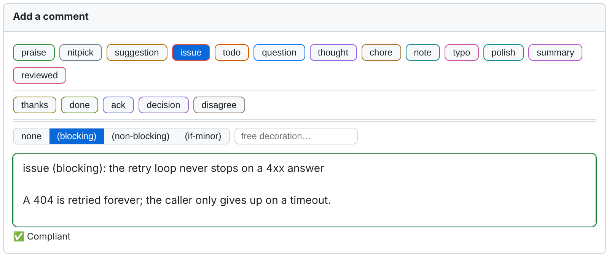
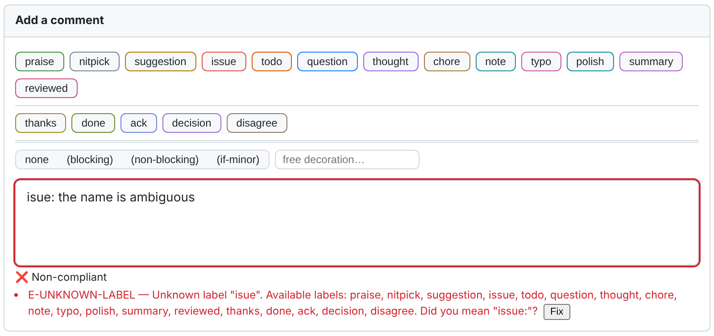
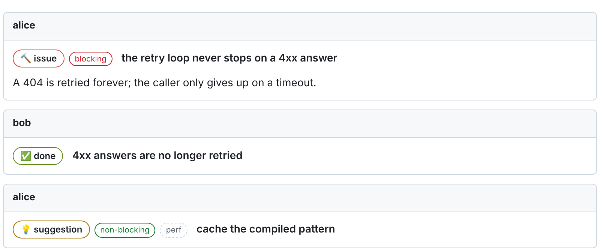

# Conventional Comments Toolkit

**Languages:** English (this file) | [Français](README-fr.md)

[](https://github.com/Reefact/conventional-comments-toolkit/actions/workflows/ci.yml)
[](https://github.com/Reefact/conventional-comments-toolkit/releases)
[](LICENSE)

**A browser extension that helps a team write [Conventional Comments](https://conventionalcomments.org/)
in code reviews, on GitHub, Azure DevOps and GitLab.**

## The problem

A review comment rarely says what it is.

```text
This loop never stops on a 4xx answer.
```

Is this a defect to fix before merging, a remark in passing, a question? The author has to
guess, and guesses the reviewer's mood along with it. Conventional Comments settles it with a
prefix:

```text
issue (blocking): the retry loop never stops on a 4xx answer
```

Everyone agrees it is a good idea. Then everyone forgets to type the prefix, mistypes it, or
uses it their own way.

## The solution

The extension adds what the convention lacks to the platform's own comment field: labels one
click away, feedback as you type, and a readable result once the comment is published.



Each mistake is named, and its fix is one click away:



Published comments show their label as a badge, and their subject as a title:



*The extension's own components, rendered from the shipped code on a test page in the colours
of GitHub's light theme. Not screenshots of github.com.*

## What you get

- **A toolbar** in every review comment field: one button per label, a selector for
  `(blocking)`, `(non-blocking)` and `(if-minor)`.
- **Keyboard input**: a completion list (`/` or `:`), abbreviations (`?ib` + `Tab` gives
  `issue (blocking): `) and direct shortcuts (`Alt+I`).
- **Validation as you type**: a status pill, a message per problem, one-click fixes.
- **Badges** on published comments, a **banner** counting the pull request's unresolved
  blocking threads, and a **filter** of threads by label.
- **Labels for replying**, which Conventional Comments does not cover: `done`, `ack`,
  `disagree`, `thanks`, plus `summary` and `reviewed` to say where a review stands. They are
  additions of this toolkit, enabled by default, that a repository can disable.
- **Rules per repository**, in one JSON file, and optionally per organisation.
- **An optional send guard** (`enforce` mode) that stops a non-compliant comment before it is
  published.
- **English and French** interface.

## Install

1. Download the archive for your browser from the
   [releases page](https://github.com/reefact/conventional-comments-toolkit/releases), unzip
   it, and load the folder (`chrome://extensions` → Developer mode → Load unpacked).
2. The extension's settings page opens by itself. Allow your platform there: until you allow
   a domain, the extension is inactive everywhere.
3. Open a pull request and click into the field of a new comment.

**→ [Getting started](docs/guide/getting-started-en.md)** walks through these three steps in
ten minutes.

## Platforms

| | GitHub | Azure DevOps | GitLab |
|---|:---:|:---:|:---:|
| Toolbar, keyboard input, validation | Yes | Yes | Yes (Markdown editor) |
| Badges, banner, thread filter | Yes | Yes | Yes |
| Repository configuration, send guard | Yes | Yes | Not yet |

GitHub.com, Enterprise Cloud and Enterprise Server; Azure DevOps Services and Server;
gitlab.com. Chrome, Edge and other Chromium browsers, Firefox 128 or later.
[What works where, in detail](docs/guide/platforms-en.md).

## Configure a repository

The extension needs no configuration. A repository that wants its own rules adds a
`.conventional-comments.json` file at the root of its default branch:

```json
{
  "version": 1,
  "mode": "assist",
  "labels": [
    { "id": "issue", "aliases": ["bug"] },
    { "id": "typo", "enabled": false }
  ],
  "toolCommands": ["/*", "@dependabot"]
}
```

[Every key, with examples](docs/guide/configuration-en.md).

## What it is, and what it is not

**It assists by default and never blocks.** In `assist` mode, a non-compliant comment is
flagged and still goes out. A team that wants more switches a repository to `enforce`, where
the send button refuses a comment with an error.

**It is a guard rail, not a wall.** The extension acts in the browser where it is installed.
A comment posted through the platform's API, another browser or a machine without the
extension is not checked.

**It does not control the merge.** Unresolved blocking threads are reported; the extension
never prevents a merge ([DEC0010](docs/idr/DEC0010-the-extension-is-the-whole-product-en.md)). A team
that wants merges gated on resolved conversations uses its platform's own settings.

**It checks the form, never the content.** Whether a remark is right, useful or kind is not
its business.

## Privacy

No comment, code or diff content ever leaves your browser. No token is stored. No site access
is requested at installation: you grant it one domain at a time. Telemetry is off by default
and cannot be turned on by a repository. [Privacy policy](PRIVACY.md).

## Documentation

**→ [Start with the ten-minute guide](docs/guide/getting-started-en.md)**

| | |
|---|---|
| [Documentation index](docs/README-en.md) | Everything, organised, in English and French |
| [Writing review comments](docs/guide/writing-comments-en.md) | The format, the toolbar, the pill, badges and the banner |
| [Keyboard input](docs/guide/keyboard-input-en.md) | Completion, abbreviations, direct shortcuts |
| [Labels and decorations](docs/guide/labels-en.md) | Every label, when to use it, what makes a comment blocking |
| [Diagnostics](docs/guide/diagnostics-en.md) | Every code of the pill, and how to fix it |
| [Configuration](docs/guide/configuration-en.md) | The repository file, key by key |
| [Modes and adoption](docs/guide/modes-and-adoption-en.md) | `off`, `assist`, `enforce`, and how to get there |
| [Deploying for an organisation](docs/guide/organization-en.md) | Shared configuration, minimum rules (the floor), hosts, telemetry |
| [FAQ and troubleshooting](docs/guide/faq-en.md) | When something does not show up |

## Labels the toolkit adds

Conventional Comments gives review **feedback** a vocabulary and says nothing about
**replying** to it. The toolkit ships labels of its own for that. They are **not part of
Conventional Comments**; a repository that wants only the upstream list disables them.

| Label | Meaning | Also accepted |
|---|---|---|
| `thanks` | Says thank you, taking no position on the point or the code. | `thx` |
| `done` | The code changed because of the remark. | `fixed` |
| `ack` | Received and accepted; the code has not changed. | `acknowledged` |
| `disagree` | Declines the remark, and the subject says why. Resolves nothing. | |
| `summary` | Recaps the review or one pass: what was checked, what is still open. | |
| `reviewed` | Closes your own review: your points are dealt with. Approves nothing. | |
| `decision` | Records, with a reason, that a point will not be addressed. | |

[When to use each, and how to disable them](docs/guide/labels-en.md#labels-that-are-not-part-of-conventional-comments).

## For AI agents

Two skills let an AI agent review a pull request, or answer its review, with this vocabulary:
[`skills/review-pull-request`](skills/review-pull-request/SKILL.md) and
[`skills/respond-to-review`](skills/respond-to-review/SKILL.md). Neither approves nor merges.
[Review skills for AI agents](docs/guide/review-skills-en.md).

## Contributing

Issues and pull requests are welcome. Start with [`CONTRIBUTING.md`](CONTRIBUTING.md).

```
npm install
npm test
npm run build
```

The layout of the repository, its commands, its continuous integration and its status against
the specification are in [`docs/development-en.md`](docs/development-en.md). The normative
specification is [`specifications-fr.md`](specifications-fr.md) (in French); the important
decisions are recorded in [`docs/idr/`](docs/idr/README-en.md).

## License

[Apache-2.0](LICENSE).
