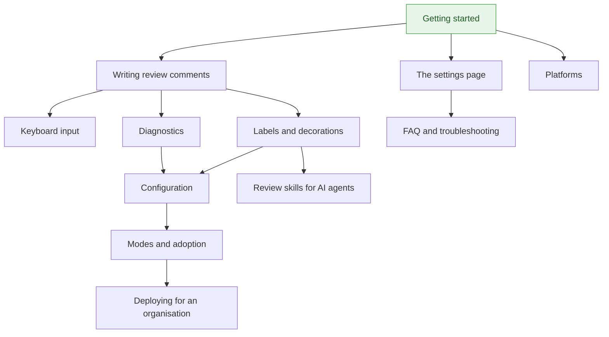

# Conventional Comments Toolkit — documentation

**Languages:** English (this file) | [Français](README-fr.md)

The toolkit is a browser extension that helps a team write
[Conventional Comments](https://conventionalcomments.org/) in code reviews: a toolbar and a
validation while you write, badges and a banner once comments are published. It assists by
default and blocks only where a team asks it to.

## Start here

**New to the extension?** → [**Getting started**](guide/getting-started-en.md): ten minutes
from nothing installed to a first comment written with the toolbar.

## Using the extension

Read them in order the first time.

| Guide | What you get |
|---|---|
| [Getting started](guide/getting-started-en.md) | Install, allow your platform, write a first comment |
| [Writing review comments](guide/writing-comments-en.md) | The format, the toolbar, the status pill, what is validated, badges, banner and filter |
| [Keyboard input](guide/keyboard-input-en.md) | The completion list, abbreviations expanded by `Tab`, `Alt` shortcuts |
| [The settings page](guide/settings-en.md) | Allowed domains, personal preferences, the status journal and the diagnostic archive |
| [FAQ and troubleshooting](guide/faq-en.md) | Why something does not show up, what a message means, what the extension is not |

## Reference

Look-up material.

| Page | Covers |
|---|---|
| [Labels and decorations](guide/labels-en.md) | Every shipped label and when to use it, the labels the toolkit adds, decorations, what makes a comment blocking |
| [Diagnostics](guide/diagnostics-en.md) | Every code the pill can show, with an example and its fix |
| [Configuration](guide/configuration-en.md) | The repository file key by key, how levels combine, recipes, upgrade notes |
| [Platforms](guide/platforms-en.md) | What works on GitHub, Azure DevOps and GitLab, which domain to allow, supported browsers |

## For a team or an organisation

| Guide | What you get |
|---|---|
| [Modes and adoption](guide/modes-and-adoption-en.md) | `off`, `assist`, `enforce`; what blocking does and does not do; the path to it and the way back |
| [Deploying for an organisation](guide/organization-en.md) | The enterprise policy: shared configuration, floor, hosts, telemetry, forced installation |
| [Review skills for AI agents](guide/review-skills-en.md) | Letting an agent review, or answer a review, with this vocabulary |
| [Privacy policy](../PRIVACY.md) | What is stored, what is sent, and what never leaves the browser |
| [Release notes](release-notes-1.x-en.md) | What changed, version by version, for people who use the extension |

## How it all fits together

## Working on the toolkit

| Document | Content |
|---|---|
| [Contributing](../CONTRIBUTING.md) | The rules of the repository, in short |
| [Development](development-en.md) | Layout, commands, continuous integration, status against the specification |
| [Specification](../specifications-fr.md) | The normative functional reference (in French) |
| [Important Decision Records](idr/README-en.md) | Why the repository is the way it is |
| [Changelog](../CHANGELOG.md) | Every notable change |
