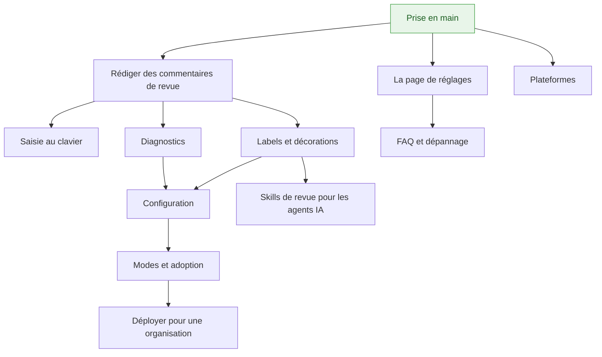

# Conventional Comments Toolkit — documentation

**Langues :** [English](README-en.md) | Français (ce fichier)

La boîte à outils est une extension de navigateur qui aide une équipe à écrire des
[Conventional Comments](https://conventionalcomments.org/) en revue de code : une barre
d'outils et une validation pendant la rédaction, des badges et un bandeau une fois les
commentaires publiés. Elle assiste par défaut et ne bloque que là où une équipe le demande.

## Par où commencer

**Vous découvrez l'extension ?** → [**Prise en main**](guide/getting-started-fr.md) : dix
minutes pour passer de rien d'installé à un premier commentaire écrit avec la barre d'outils.

## Utiliser l'extension

À lire dans l'ordre la première fois.

| Guide | Ce que vous y trouvez |
|---|---|
| [Prise en main](guide/getting-started-fr.md) | Installer, autoriser votre plateforme, écrire un premier commentaire |
| [Rédiger des commentaires de revue](guide/writing-comments-fr.md) | Le format, la barre d'outils, la pastille, ce qui est validé, les badges, le bandeau et le filtre |
| [Saisie au clavier](guide/keyboard-input-fr.md) | La liste de complétion, les abréviations dépliées par `Tab`, les raccourcis `Alt` |
| [La page de réglages](guide/settings-fr.md) | Domaines autorisés, préférences personnelles, journal d'état et archive de diagnostic |
| [FAQ et dépannage](guide/faq-fr.md) | Pourquoi quelque chose ne s'affiche pas, ce que veut dire un message, ce que l'extension n'est pas |

## Référence

Des pages à consulter au besoin.

| Page | Couvre |
|---|---|
| [Labels et décorations](guide/labels-fr.md) | Chaque label livré et quand l'employer, les labels que la boîte à outils ajoute, les décorations, ce qui rend un commentaire bloquant |
| [Diagnostics](guide/diagnostics-fr.md) | Chaque code que la pastille peut afficher, avec un exemple et sa correction |
| [Configuration](guide/configuration-fr.md) | Le fichier du dépôt clé par clé, la combinaison des niveaux, des recettes, les notes de migration |
| [Plateformes](guide/platforms-fr.md) | Ce qui fonctionne sur GitHub, Azure DevOps et GitLab, quel domaine autoriser, les navigateurs pris en charge |

## Pour une équipe ou une organisation

| Guide | Ce que vous y trouvez |
|---|---|
| [Modes et adoption](guide/modes-and-adoption-fr.md) | `off`, `assist`, `enforce` ; ce que le blocage fait et ne fait pas ; le chemin pour y arriver et le retour arrière |
| [Déployer pour une organisation](guide/organization-fr.md) | La politique d'entreprise : configuration partagée, plancher, hôtes, télémétrie, installation forcée |
| [Skills de revue pour les agents IA](guide/review-skills-fr.md) | Faire relire un agent, ou le faire répondre à une revue, avec ce vocabulaire |
| [Politique de confidentialité](../PRIVACY.md) | Ce qui est stocké, ce qui est envoyé, et ce qui ne quitte jamais le navigateur |
| [Notes de version](release-notes-1.x-fr.md) | Ce qui a changé, version par version, pour les personnes qui utilisent l'extension |

## Comment tout cela s'articule

## Travailler sur la boîte à outils

| Document | Contenu |
|---|---|
| [Contribuer](../CONTRIBUTING.md) | Les règles du dépôt, en bref (en anglais) |
| [Développement](development-en.md) | Organisation, commandes, intégration continue, état d'avancement (en anglais) |
| [Spécification](../specifications-fr.md) | La référence fonctionnelle normative |
| [Registre des décisions](idr/README-fr.md) | Pourquoi le dépôt est ce qu'il est |
| [Changelog](../CHANGELOG.md) | Chaque changement notable (en anglais) |
| [Architecture](architecture-fr.md), [exploitation](operations-fr.md), [releases](release-fr.md) | Documents de l'équipe |
