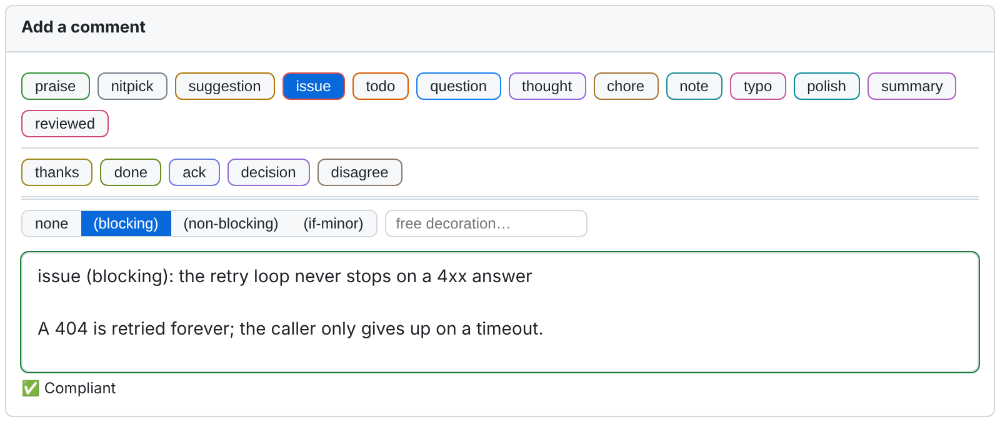
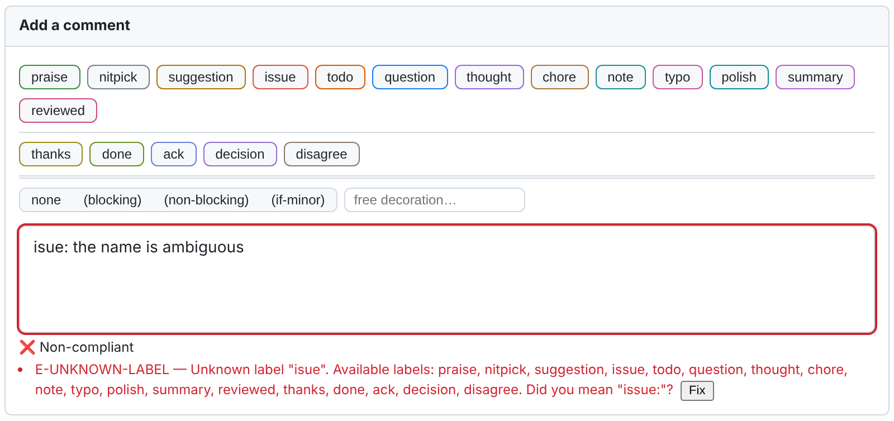
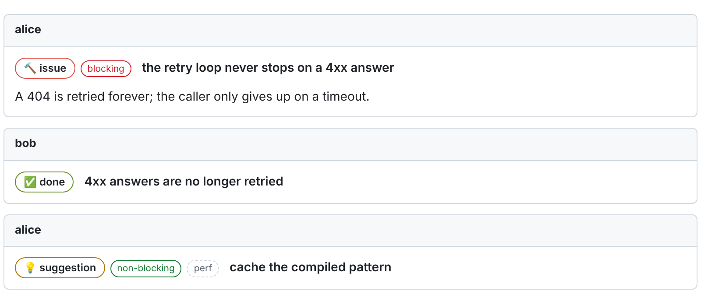

# Writing review comments

**Languages:** English (this file) | [Français](writing-comments-fr.md)

What the extension adds to a pull request page: a toolbar and a status pill while you write,
badges, a banner and a filter once comments are published.

## The format

A review comment starts with a prefix line:

```text
<label> [(<decoration>[, <decoration>]…)]: <subject>

[<discussion>]
```

```text
issue (blocking): the retry loop never stops on a 4xx answer

A 404 is retried forever; the caller only gives up on a timeout.
```

- The **label** says what kind of comment this is. It is required
  ([labels](labels-en.md)).
- A **decoration** qualifies it, most often to say whether the point blocks
  ([decorations](labels-en.md#decorations)).
- The **subject** is a one-line summary. It is required.
- The **discussion** is everything outside the prefix line, in free Markdown.

This is the format of [Conventional Comments](https://conventionalcomments.org/). The
extension is stricter than that page only about the shape of the prefix, so that a machine
can read it; it never judges the wording of your subject.

A few variations are tolerated: spaces before the colon are accepted (`issue : subject`, as
French typography writes it), a leading emoji is ignored, and `(ux,non-blocking)` is read like
`(ux, non-blocking)`.

## The toolbar

A toolbar is added to every comment field the extension handles.



*The extension's own components, rendered from the shipped code on a test page in the colours of
GitHub's light theme. Not a screenshot of github.com.*

| Row | What it holds |
|---|---|
| First | The labels that raise a point (`praise`, `nitpick`, `suggestion`, `issue`…), then the two that say where a review stands (`summary`, `reviewed`). |
| Second, under a thin rule | The labels that answer a point: `thanks`, `done`, `ack`, `decision`, `disagree`. |
| Third, under a double rule | The decorations: *none*, `blocking`, `non-blocking`, `if-minor`, and a field for a free decoration such as `security`. |

- **Clicking a label** inserts its prefix, or replaces the one already there. The text you
  typed is kept.
- **Clicking the active label again** removes the prefix.
- **Hovering a label** says when to use it, with an example.
- **Choosing a decoration** adds it to the prefix: `issue` then `non-blocking` gives
  `issue (non-blocking): `.

Each row wraps onto further lines when the field is narrow; labels and decorations never share
a row. You can put your most-used labels first with *Button order* in the
[settings page](settings-en.md#local-preferences), and write prefixes without the mouse with
the [keyboard input](keyboard-input-en.md).

## The status pill

A pill under the field says where the comment stands, as you type:

| Pill | Meaning |
|---|---|
| ✅ *Compliant* | Nothing to report. |
| ⚠️ *Compliant, with warnings* | The comment is compliant; something could be better. Warnings never block. |
| ❌ *Non-compliant* | At least one error. In `enforce` mode the comment cannot be sent ([modes](modes-and-adoption-en.md)). |
| *Configuration unread* | The extension could not read the repository's rules. It assists without knowing them and does not block. |

The field's border takes the colour of the current state. Under the pill, each problem is listed
with its code and a message; when the correction can be computed, a **Fix** button applies it
in one click. The [diagnostics reference](diagnostics-en.md) explains every code.

```text
isue: the name is ambiguous
```



When the configuration itself has a problem (an unknown key, an invalid file, a key the
organisation does not let a repository relax), the pill reports it after the diagnostics. These
notices do not change the verdict.

## What is validated, and what is not

| Where you write | Format validated | Can open a blocking thread |
|---|:---:|:---:|
| A comment on a line of the diff | Yes | Yes |
| The first comment of a thread | Yes | Yes |
| A general comment on the pull request | Yes | Depends on the platform ([platforms](platforms-en.md)) |
| The body of a review submitted as a whole | Yes (`scope.validateReviewSummary`) | No |
| A reply in an existing thread | **No by default** (`scope.validateReplies`) | No |
| A reply that carries the `decision` label | Always | No |
| The description of the pull request | No | No |

Editing a comment is validated like writing it.

A comment is **exempt**, and gets no diagnostic at all, when:

- its body is empty (so you can still approve without writing anything);
- nothing is left once code blocks and quotations are removed;
- it starts with a command addressed to a tool, such as `/rebase` or `@dependabot rebase`,
  when the repository declares them in `toolCommands`;
- it matches a pattern of `allowlistPatterns`, or its author is in `exemptUsers`.

Those three keys are empty by default ([configuration](configuration-en.md)).

A comment that contains a native **suggestion block** of the platform needs no prefix: it is
read as a `suggestion`. If you write a prefix above the block, your prefix wins.

## Once comments are published



**Badges.** The label of a published comment is shown as a coloured badge, with its icon, and
each decoration as a badge of its own. Hovering the label badge says what the comment means
for whoever reads it. When it can be done without losing anything, the prefix is hidden from
the text, the badges take its place and the subject is emphasised, so the line reads as a
title. The stored comment is never modified: editing it shows the prefix as written, and
anyone without the extension sees the plain text.

**Banner.** At the top of the pull request, a banner counts the **unresolved blocking
threads** and links to each of them. A thread is blocking when its first comment is
([what makes a comment blocking](labels-en.md#what-makes-a-comment-blocking)). The banner
reports; it never prevents a merge.

**Thread filter.** Above the threads, a row of chips filters them by label. It only hides
threads on your screen.

**Review-session marker.** A line that contains only `[session:<name>]` says which review
session wrote a comment, which helps when several AI agents review the same pull request
([review skills](review-skills-en.md)). The extension hides that line and shows a discreet
`🤖 session: <name>` at the bottom of the comment. Validation ignores the marker,
except that a comment carrying more than one gets the warning `W-SESSION-MULTIPLE`.

## Closing a blocking thread without making the change

Sometimes the people responsible for the pull request decide not to address a blocking point:
out of scope, debt accepted, decision taken elsewhere. That is a review decision, and it is
recorded in the thread, as a reply:

```text
decision: out of scope for this pull request, debt tracked in PROJ-142

The author of the comment is away and the fix must ship today.
```

A `decision` must give its reason in at least 20 characters
(`rules.minDecisionSubjectLength`). It records the choice where the discussion took place. It
does not resolve the thread: you still resolve it with the platform's own control.
