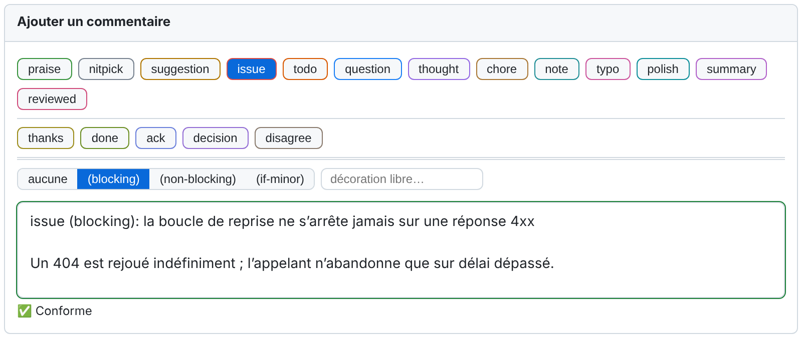
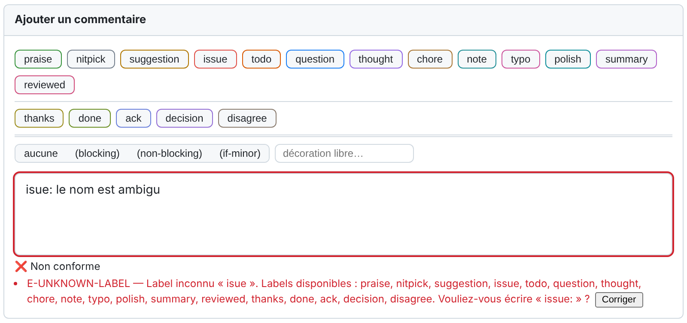
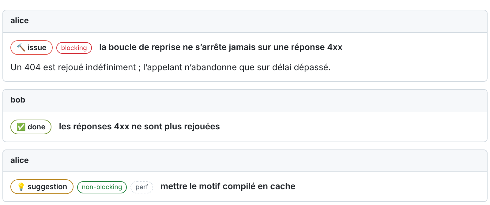

# Écrire des commentaires de revue

**Langues :** [English](writing-comments-en.md) | Français (ce fichier)

Ce que l'extension ajoute à la page d'une pull request : une barre d'outils et une pastille de
validation pendant que vous écrivez, des badges, un bandeau et un filtre une fois les
commentaires publiés.

## Le format

Un commentaire de revue commence par une ligne de préfixe :

```text
<label> [(<decoration>[, <decoration>]…)]: <subject>

[<discussion>]
```

```text
issue (blocking): la boucle de réessai ne s'arrête jamais sur une réponse 4xx

Un 404 est réessayé indéfiniment ; l'appelant n'abandonne que sur un délai dépassé.
```

- Le **label** dit de quel type de commentaire il s'agit. Il est obligatoire
  ([labels](labels-fr.md)).
- Une **décoration** le qualifie, le plus souvent pour dire si le point est bloquant
  ([décorations](labels-fr.md#décorations)).
- Le **sujet** est un résumé sur une ligne. Il est obligatoire.
- La **discussion** est tout ce qui se trouve hors de la ligne de préfixe, en Markdown libre.

C'est le format de [Conventional Comments](https://conventionalcomments.org/). L'extension
n'est plus stricte que cette page que sur la forme du préfixe, pour qu'une machine puisse le
lire ; elle ne juge jamais la formulation de votre sujet.

Quelques tolérances : les espaces avant le deux-points sont acceptées (`issue : sujet`, comme
l'écrit la typographie française), un emoji en tête est ignoré, et `(ux,non-blocking)` est lu
comme `(ux, non-blocking)`.

## La barre d'outils

Une barre d'outils est ajoutée à chaque champ de commentaire que l'extension prend en charge.



*Les composants propres à l'extension, rendus à partir du code livré sur une page de test aux
couleurs du thème clair de GitHub. Ce n'est pas une capture d'écran de github.com.*

| Rangée | Ce qu'elle contient |
|---|---|
| Première | Les labels qui soulèvent un point (`praise`, `nitpick`, `suggestion`, `issue`…), puis les deux qui disent où en est une revue (`summary`, `reviewed`). |
| Deuxième, sous un filet fin | Les labels qui répondent à un point : `thanks`, `done`, `ack`, `decision`, `disagree`. |
| Troisième, sous un filet double | Les décorations : *aucune*, `blocking`, `non-blocking`, `if-minor`, et un champ pour une décoration libre telle que `security`. |

- **Cliquer sur un label** insère son préfixe, ou remplace celui qui est déjà là. Le texte
  que vous avez saisi est conservé.
- **Cliquer à nouveau sur le label actif** retire le préfixe.
- **Survoler un label** indique quand l'employer, avec un exemple.
- **Choisir une décoration** l'ajoute au préfixe : `issue` puis `non-blocking` donne
  `issue (non-blocking): `.

Chaque rangée passe à la ligne sur elle-même quand le champ est étroit ; labels et décorations
ne partagent jamais une rangée. Vous pouvez placer en tête vos labels les plus utilisés avec
*Ordre des boutons* dans la [page de réglages](settings-fr.md#préférences-locales), et écrire
les préfixes sans la souris grâce à la [saisie au clavier](keyboard-input-fr.md).

## La pastille de validation

Une pastille, sous le champ, dit où en est le commentaire, au fil de la saisie :

| Pastille | Signification |
|---|---|
| ✅ *Conforme* | Rien à signaler. |
| ⚠️ *Conforme, avec avertissements* | Le commentaire est conforme ; quelque chose pourrait être mieux. Les avertissements ne bloquent jamais. |
| ❌ *Non conforme* | Au moins une erreur. En mode `enforce`, le commentaire ne peut pas être envoyé ([modes](modes-and-adoption-fr.md)). |
| *Configuration non lue* | L'extension n'a pas pu lire les règles du dépôt. Elle assiste sans les connaître et ne bloque pas. |

La bordure du champ prend la couleur de l'état. Sous la pastille, chaque problème est listé
avec son code et un message ; quand la correction peut être calculée, un bouton **Corriger**
l'applique en un clic. La [référence des diagnostics](diagnostics-fr.md) explique chaque code.

```text
isue: le nom est ambigu
```



Quand la configuration elle-même a un problème (une clé inconnue, un fichier invalide, une clé
que l'organisation ne laisse pas un dépôt assouplir), la pastille le dit après les
diagnostics. Ces avis ne changent aucun verdict.

## Ce qui est validé, et ce qui ne l'est pas

| Où vous écrivez | Format validé | Peut ouvrir un fil bloquant |
|---|:---:|:---:|
| Un commentaire sur une ligne du diff | Oui | Oui |
| Le premier commentaire d'un fil | Oui | Oui |
| Un commentaire général sur la pull request | Oui | Selon la plateforme ([plateformes](platforms-fr.md)) |
| Le corps d'une revue soumise en bloc | Oui (`scope.validateReviewSummary`) | Non |
| Une réponse dans un fil existant | **Non par défaut** (`scope.validateReplies`) | Non |
| Une réponse qui porte le label `decision` | Toujours | Non |
| La description de la pull request | Non | Non |

Modifier un commentaire est validé comme l'écrire.

Un commentaire est **exempté**, et ne reçoit aucun diagnostic, quand :

- son corps est vide (approuver sans texte reste possible) ;
- il ne reste rien une fois les blocs de code et les citations retirés ;
- il commence par une commande adressée à un outil, comme `/rebase` ou `@dependabot rebase`,
  quand le dépôt les déclare dans `toolCommands` ;
- il correspond à un motif de `allowlistPatterns`, ou son auteur figure dans `exemptUsers`.

Ces trois clés sont vides par défaut ([configuration](configuration-fr.md)).

Un commentaire qui contient un **bloc de suggestion** natif de la plateforme n'a pas besoin de
préfixe : il est lu comme une `suggestion`. Si vous écrivez un préfixe au-dessus du bloc,
c'est votre préfixe qui l'emporte.

## Une fois les commentaires publiés



**Badges.** Le label d'un commentaire publié s'affiche sous la forme d'un badge coloré, avec
son icône, et chaque décoration sous la forme d'un badge distinct. Survoler le badge du label
indique ce que le commentaire signifie pour qui le lit. Quand c'est possible sans rien perdre,
le préfixe est masqué dans le texte, les badges prennent sa place et le sujet est mis en
valeur, si bien que la ligne se lit comme un titre. Le commentaire stocké n'est jamais
modifié : le modifier montre le préfixe tel qu'il a été écrit, et quiconque n'a pas
l'extension voit le texte brut.

**Bandeau.** En haut de la pull request, un bandeau compte les **fils bloquants non résolus**
et renvoie à chacun d'eux. Un fil est bloquant quand son premier commentaire l'est
([ce qui rend un commentaire bloquant](labels-fr.md#ce-qui-rend-un-commentaire-bloquant)). Le
bandeau informe ; il n'empêche jamais une fusion.

**Filtre de fils.** Au-dessus des fils, une rangée de puces les filtre par label. Il ne
masque les fils que sur votre écran.

**Marqueur de session de revue.** Une ligne `[session:<nom>]`, seule sur sa ligne, dit quelle
session de revue a écrit un commentaire, ce qui aide quand plusieurs agents IA relisent la
même pull request ([skills de revue](review-skills-fr.md)). L'extension masque cette ligne et
affiche une mention discrète `🤖 session: <nom>` en bas du commentaire. Le marqueur ne fait
pas partie du commentaire pour la validation.

## Clore un fil bloquant sans faire le changement demandé

Il arrive que ceux qui portent la PR décident de ne pas traiter un point bloquant : hors
périmètre, dette acceptée, décision prise ailleurs. C'est une décision de revue, et elle
s'écrit dans le fil, en réponse :

```text
decision: hors périmètre de cette pull request, dette suivie en PROJ-142

L'auteur du commentaire est absent et le correctif doit être livré aujourd'hui.
```

Une `decision` doit énoncer son motif en au moins 20 caractères
(`rules.minDecisionSubjectLength`). Elle consigne le choix là où la discussion a eu lieu ;
elle ne résout pas le fil, ce qui reste un geste de la plateforme.
